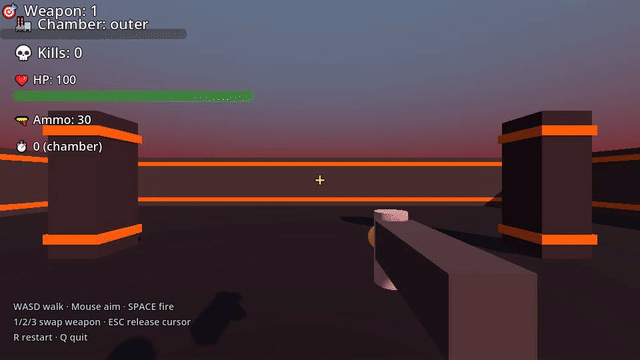
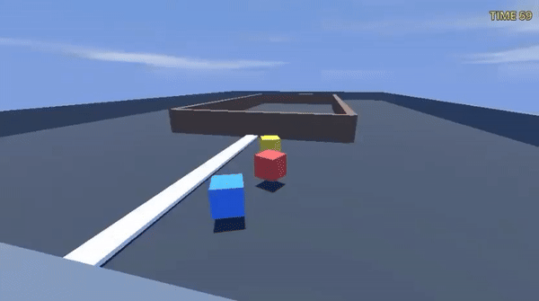
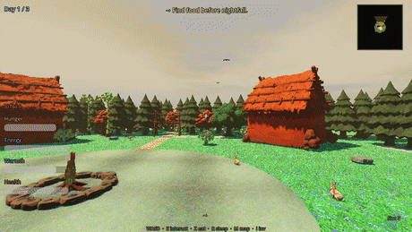
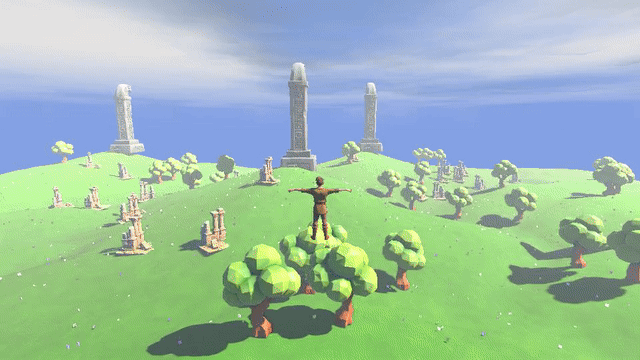
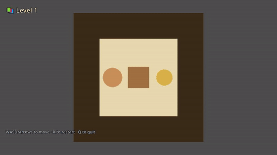
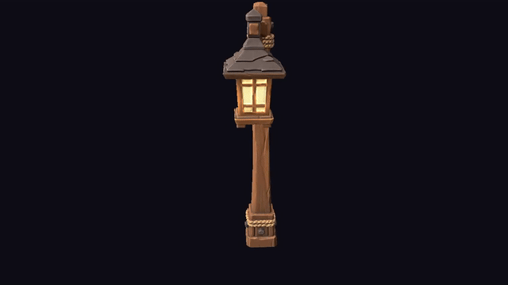
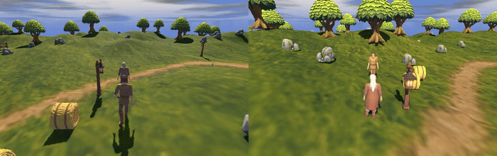

# Yume (夢)

**Yume is a programmable, explicit _world model_ built on Godot 4.6.1.**
You write a world's entities and rules as **pure JSON**. A small
interpreter advances that world tick by tick. Godot then *projects* the
state to pixels, audio, HUD or text.

The engine ships a fixed set of **primitives and an interpreter**. It has
no game-specific GDScript. You describe a world, and you never edit the
engine (Invariants #1 and #8, ADR 0021). **Games are one use of Yume, not
the only one.**

> **Why "Yume"?** 夢 (_yume_) is Japanese for **"dream."** You describe a
> world in plain language, and it becomes something you can run, with no
> code for that world. Imagine it, and it exists.

> ## 🤖 Built by Claude, for Claude
> Claude (Anthropic's AI) wrote **all of this repository**. Claude is also
> **the intended operator**. The conventions, build steps and run workflow
> are in `CLAUDE.md` and `.claude/` for that reason.
>
> **The recommended way to use Yume: open it in
> [Claude Code](https://claude.com/claude-code) and ask in plain English.**
> For example: "generate a game about X", "run the tests", or "record a
> headless multiplayer video". Claude knows the invocation details
> (syncing, `--path .`, asset imports, the visual-QA gate). You *can* run
> the commands yourself, but they are easy to get wrong. To set up, see
> **[INSTALLATION.md](INSTALLATION.md)**.

_Status: **pre-1.0, experimental** (`0.x`). The 7 primitives and the JSON
schema are not frozen yet. `1.0` will freeze the contract. Last updated:
2026-10-16._

---

## Demos

You describe a world in plain English. An LLM writes the JSON. A fixed
engine runs it on Godot. These examples came out of that process:

### 🔫 `doomarena3d`: a first-person arena shooter


Movement, shooting, enemies and deaths are all JSON rules. The engine has
no code for this game.

### 🏎️ An arcade racer, generated end to end from a prose pitch


Made with `/yume-design "<pitch>"`. It is code-drawn, so it needs no asset
generation.

### 🌲 A walkable 3D scene, from the text-to-3D-world pipeline


Made with `/yume-create-scene`.

### 🗿 Scene-generation algorithm (experimental)


Text, then a semantic map, then a placed 3D world. It is rough, but it
works end to end. This is an active research direction.

### 🧩 Sokoban: a committed 2D demo (runs on a fresh clone, no API keys)


### 🎥 Camera-orbit trajectory: the 3D rendering and camera system


### 🌐 Server-authoritative multiplayer (in development)


---

## What Yume is for

> *"Everything is a world model if you squint hard enough."*
> — [Zihan "Zenus" Wang (@wzenus)](https://x.com/wzenus/status/2002092055884124297)

A world model is a transition function `f(state, action) → next_state`.
Yume lets you **write `f` as JSON** and run it:

- **JSON is the world-spec language.** Entities are the state. Rules
  (`{trigger, query, effect}`) are the transition function.
- **The runtime is the interpreter.** It runs the spec and moves the
  state forward one tick at a time.
- **Godot is the projection function.** It turns state into pixels,
  audio, HUD or text. (ADR 0021: *expose Godot, do not reimplement it.*)

**Games are one consumer.** The same substrate serves other uses:

| Use | How |
|---|---|
| 🎮 **Games** | the Godot projection: a playable build |
| 🤖 **RL and agent-evaluation testbeds** | deterministic, seedable, gym-like stepping (ADR 0060) |
| 🏞️ **Scene and world generation** | prose-to-3D-scene pipelines (`/yume-create-scene`) |
| 🧠 **Training data for neural world models** | roll out a JSON world, record `(state, action, next_state)` trajectories, and train an implicit model (Dreamer-style or Genie-style) that approximates the same `f` at scale |

The last row is the thesis. Yume aims to be a **clean, authorable,
*explicit* substrate** that connects to *implicit* (neural) world models.
You can interpret a JSON world directly. You can also use it as a source
of reproducible training data.

The seven primitives (Entity, Tag, Rule, Trigger, Effect, Query,
Relation) are the **minimal vocabulary** for discrete-time worlds. That
is why the engine refuses game-specific verbs. There is no `damage`,
`heal` or `attack` effect. Those are *content*, and you build them from
primitives.

### Why a programmable world model

Two trends motivate Yume:

1. **Programming is becoming unstructured.** With LLMs (and VLMs such as
   Qwen), you describe *what you want* in natural language, and the model
   writes the code. The interface to software moves from syntax to intent.
2. **World-model research is moving fast.** Neural world models
   ([Genie](https://arxiv.org/abs/2402.15391)-style generative interactive
   environments and [Dreamer](https://arxiv.org/abs/2301.04104)-style
   latent models) train on large datasets of action-labelled
   trajectories. These are frames paired with the actions that produced
   them. That data is expensive. Studios pay annotators to play games and label
   frames, or they build reference-to-video corpora by hand.

Yume sits where these two trends meet. A neural model *learns* a world's
dynamics from millions of frames. In Yume, you **write the dynamics
explicitly**: the physics, the rules, the goal. This is the way you
program a game, or the way you set up sensors and a goal for a robot.

Plain prose is too unstructured to run. So Yume's substrate is structured
**JSON**, and an LLM (Claude) compiles prose into JSON. The world model is
then *programmable*, because you write it in language. It is also
*explicit*, because it is code on a deterministic engine that you can
read, seed and diff, not opaque weights.

> *Why "explicit"?* Because Yume's transition function
> `f(state, action) → next_state` is literally code on a deterministic
> engine. (Half joking, half serious: our own universe runs a small set of
> fixed physical laws, deterministic from its initial conditions, much
> like a game engine. Yume makes that analogy authorable.)

The two kinds of world model complement each other:

- **Explicit (Yume):** clean, authorable and deterministic. It is cheap to
  roll out and cheap to *label*, because every transition is exact.
- **Implicit (neural):** it scales to messy, photoreal, open-ended
  dynamics that nobody wants to write by hand.

📖 **Full vision:** [`docs/guideline/00_what_yume_is.md`](docs/guideline/00_what_yume_is.md).

### Research directions

Yume helps game development. It also gives researchers a concrete
substrate. It lets you probe these open questions:

1. **Does an LLM need to generate a whole game, or only the world rules?**
   Most "AI makes a game" systems generate engine code for each game.
   Yume's bet, which holds so far, is that the LLM only needs to
   **understand the framework and the world's rules** and emit JSON. The
   fixed interpreter does the rest. There is less to get wrong and much
   more to check.
2. **LLM-authored 3D structure.** Some of Claude's meshes and kit-of-parts
   composites in Yume already look good. More training data could help.
   So could tools such as Blender's MCP bridge, or models that write
   *procedural-generation code* (see
   [**3DCodeBench**](https://arxiv.org/abs/2606.01057)). With them,
   Claude may eventually generate solid 3D structure directly. It may also excel at
   procedural generation. Yume is a place to try this.
3. **Scene generation.** `/yume-create-scene` is an end-to-end pipeline:
   text, concept, semantic map, placement, assets. It runs, but it is
   **not reliable yet**, and it has **no aesthetic sense**. This direction
   is open: the pipeline has a harness, but the problem is not solved. A
   strong text-to-3D-world API (see
   [**WorldGen**](https://arxiv.org/abs/2511.16825)) in this slot would, I
   believe, *complete* the framework.
4. **Assist, do not replace.** Yume does not try to replace game studios.
   Gameplay is art. 3D is art. Scene composition is art. Story is art. A
   studio can plug in its *own* aesthetic, and its scene generation does
   not need to be Claude's. A non-programmer can make a game from one
   strong idea in any **one** of those areas, with no engine work.
5. **A research substrate, broadly.** A world is explicit JSON on a
   deterministic engine. So one artifact serves several research areas:
   world-model training data, 3D, scene and audio generation, and game
   AI. For game AI, Yume has the
   [ADR 0020](docs/adr/0020-external-agent-ipc.md) external-agent IPC
   seam and the
   [ADR 0060](docs/adr/0060-deterministic-pomdp-pluggable-io.md) gym-like
   env. As scene, 3D and asset-generation APIs mature, the framework's
   remaining gaps close from the outside in.

> Claude wrote **all of this framework**. The author reviewed the code,
> but freely admits that an LLM now manages a codebase of this size faster
> than they could alone. In the end, the *ideas* matter most. Yume is a
> bet on where they point.

---

## Quick start

Set up once with **[INSTALLATION.md](INSTALLATION.md)** (Godot 4.6.1 and a
Python venv). Then open the repo in **Claude Code** and ask:

> *"Generate a game: a roguelike where vampires steal HP from light sources."*
> *"Run the engine tests."*  ·  *"Record a 4-player headless multiplayer video."*

Claude runs the right pipeline and handles the invocation details.

**To run it yourself:** most demos are gitignored. Generate one, or use a
committed example (`sokoban`, `doomarena3d`, `lanterns`).

```bash
/yume-design "<your prose pitch>" --autonomous   # prose → full game
./scripts/play.sh <name>                         # play (Windows binary)
./scripts/play.sh <name> --capture               # render a frame for visual QA
```

⚠️ Manual runs have traps: the `cd "$TEMPLATE_DST" && --path .` rule, the
asset `--import` step, and more. See `CLAUDE.md` § "Running Godot". This
is why we recommend that Claude runs the commands.

---

## How it works

A **game** is a folder of JSON under `godot/data/demo_<name>/`. The engine
loads it into **entities** (dicts with tags, properties, state and
position) and **rules** (`{trigger, query, effect}`).

On each tick, the engine finds the rules whose trigger matches: a tick
passed, a contact happened, an input arrived, or a signal fired. It runs
each rule's query to pick entities, and it applies the rule's effect (a
primitive verb such as `state_set`, `velocity_set` or `spawn`). The
renderer is a separate, read-only layer that draws entity state.

**Seven primitives:** Entity, Tag, Rule, Trigger, Effect, Query, Relation
(ADR 0001).

The [engine tour](docs/engine-reference/engine-tour.md) explains the rest.
It covers the repository layout, the engine file map, the boot, frame
and tick flows, the input flow, the runtimes and the data layer.

---

## Generation pipeline (prose → game)

`/yume-design` is the **single orchestrator**. It is a *skill* that loads
into Claude's own context. It calls specialist skills in order, and each
one writes one part of the game's JSON. The reviewer and QA skills run as
forked subagents, so their logs stay out of the main context (ADR 0082).

A game has **three layers with separate file ownership**, so no layer
overwrites another (ADR 0067):

```
/yume-design "<pitch>"  [--scene]  [--with-assets]  [--autonomous]

 Phase W   (--scene)        yume-scene-class-catalog ─▶ compose_scene --no-shell
   WORLD                      └─ image-gen (gpt-image) ─▶ compose_world (3D scene:
                                 biome ground, water, heightmap, placed props)
                                 + compose_shell (walk/jump/sprint + camera + .tscn)
 Phases 1-4 (always)        game-designer ─▶ game-reviewer ─▶ game-planner ─▶
   GAME                     level-designer ─▶ [combining-logic / economy / story]* ─▶
                            systems-designer ─▶ content-designer ─▶
                            asset-designer
                            (+ soul skills: flavor-writer, audio, juice, lighting,
                             screen-flow, save-policy, tutorial — as the GDD needs)
 Phase A   (--with-assets)  tools.yume_assetgen  (gpt-image concepts + Tripo3D .glb,
   ASSETS                     patches visual.* in place)
 Phase QA  (always)         qa-tester ─▶ playtest ─▶ visual-designer ─▶
                            gdd-coverage-tracker  (GDD = contract; no silent drops)
 on demand                  tech-director  (gates engine / new-primitive / ADR changes)
```

`*` These run only when the GDD has crafting, an economy or a story.
**Genre detection** adds strict specialists where they exist (`shooter`,
`merchant` and `racing` designers, with their reviewers). The generic
`game-designer` and `game-reviewer` are the base.

**How the layers stay separate:**

- World writes `scene.json`, `entities/auto_gen.json` and `assets/`.
- Game writes `entities/<slug>.json`, `world/rules/*.json` and `hud.json`.
- Assets changes `visual.*` on existing defs.

The engine loads every `entities/*.json` and `world/rules/*.json` file and
merges them by id. So the layers combine with no merge code. **With no
flags, you get a code-drawn single-player game that needs no API keys.**
This is also the fallback when a key is missing.

### Standalone authoring pipelines (outside `/yume-design`)

| Slash command | Makes | Driver script(s) |
|---|---|---|
| `/yume-create-scene` | a walkable 3D scene or diorama (scene **and** walk shell) | `compose_scene` → `compose_world` + `compose_shell` (+ `compare_semantic` QA) |
| `/yume-hud-author` | `hud.json` that fits a wireframe | `wireframe_to_hud` (preprocess/postprocess) |
| `/yume-screen-author` | `screens.json` that fits a wireframe | `wireframe_to_screen` |
| `/yume-map-author` | a level's instances and patterns from a 2D sketch | `compose_map` + `wireframe_to_map` |

---

## Features

This is what the framework does today. Content is JSON unless a row says
otherwise. Most rows map to an ADR under `docs/adr/`.

| Area | Capabilities |
|---|---|
| **Core engine** (primitives + interpreter, ADR 0001 and 0021) | 7 primitives. 10 trigger types (`tick`, `frame_tick`, `contact`, `signal`, `input`, `spawn`, `despawn`, `relation_changed`, `scheduled`, `overlap`). 50 effect verbs. They cover state, spawn and remove, transform, relations and relation state, tags, velocity, arrays, `pathfind_to` and `raycast_hit`. They also cover zones, the calendar clock, level subroutines and the shell lifecycle. A formula evaluator with whitelisted math. A fixed-rate tick on the physics clock and a phase-flush scheduler. `@lib` and `$include` reuse across games (ADR 0027). Rule macros. Deterministic scatter, ring and grid placement. |
| **Rendering and world** | 2D and 3D renderers. 8 camera modes (top-down, side-scroll, isometric, third-person, first-person, fixed and free-cam, in 2D and 3D). GLB meshes, kit-of-parts composites, code-built meshes, MultiMesh decoration and trimesh static worlds. Shaders as JSON. Multi-biome ground from a semantic map. Water, day and night, fog and a procedural sky. |
| **System primitives** | Schedules, lifecycle and aging, zones and relation state. The calendar clock (`advance_time`), level subroutines, one-shot rules and simulation tiers. Vehicles, multi-actor control with scripted-policy AI, pathfinding, procedural generation, grid placement and animation. |
| **"Complete game" layer** | declarative screens and modals, save and load, tutorial overlays, a settings schema, HUD from JSON, event-to-SFX audio, juice (shake, flash, particles). |
| **Physics** | Godot PhysicsServer and CharacterBody motion, AABB blockers, camera-relative WASD. |
| **Generation pipelines** (LLM in the loop) | `/yume-design` turns prose into a full game. `--scene` generates a 3D world to play in, and `--with-assets` adds AI textures and meshes. The three layers (World, Game, Assets) own separate files (ADR 0067). Standalone authors: `/yume-create-scene`, `/yume-hud-author`, `/yume-screen-author`, `/yume-map-author`. **40 specialist skills**. Optional codegen and AI assetgen (textures with OpenAI or Gemini, meshes and rigs with Tripo3D, shaders). See [§ Generation pipeline](#generation-pipeline-prose--game). |
| **Networking and I/O** (ADR 0060–0066) | A deterministic, gym-like stepping env (Python) with a determinism oracle. Lockstep. **Client-server (server-authoritative)** play with data-driven `net.json` replication. Synced animation. **Record-then-replay headless video** of synced sessions with N players (`scripts/net_video.py`: a normal window or `--linux` headless, GPU, grid, 60 fps). |
| **Tooling and QA** | 37 static validators. GitHub Actions CI (the validators, the engine unit tests and the scenario tests of the committed examples) and a pre-commit hook. Playwright-style scenario tests. Visual QA (Gemini and Claude vision). A tech-director invariant gate. |

---

## Known gaps

This is an honest list of where the framework is thin or demo-grade.

| Area | Gap |
|---|---|
| **Networking** (newest, most demo-grade) | It is purely server-authoritative, so there is **no client-side prediction**. Your own character has round-trip input latency, and there is no lag compensation. It works on **LAN or localhost only**: no NAT, relay or matchmaking, no reconnection, and no saved multiplayer state. Only the **walk shell** is networked. The genre games (merchant, shooter, ...) have no network tests. |
| **Headless-render fidelity** | The truly windowless `--headless-render` path is a custom Godot patch on **4.7-beta**. It cannot load our **4.6.1** assets, so it renders boxes. It needs a port to 4.6.1. The Xvfb path works (real meshes, no window), but WSL limits it to GPU-readback speed. A Linux machine with a native GPU runs it fast. |
| **Animation** | No validator checks that a declared `animation_clip` exists in the mesh. A mismatch falls back silently and looks laggy (this happened in `tiny_village`). `anim_phase` has a fixed cadence, not one that follows speed, so feet slide at speed. There are no blend trees, no IK and no root motion. |
| **Formula and query** | Formulas have no ternary: Godot 4.6.1's Expression does not support it, so the engine rejects `a if c else b`. Write `b + (a - b) * float(c)`. `self.nearest({…})` is **not implemented**, so a formula cannot run a spatial query. Use a `contact` trigger instead. |
| **Pipelines** | The 3 generation layers no longer overwrite each other (ADR 0067). One problem remains. A new run of `compose_world` or `compose_shell` regenerates the World and shell files, so it overwrites hand edits to them. The game's own `entities/<slug>.json` and `world/rules/` are safe. `/yume-create-scene`'s walk shell still conflicts with a `/yume-design` game folder. Use `--scene` instead. |
| **QA tooling** | The objective visual test plans (`tools/visual_qa/run_plan.py`) support 3D games only. |
| **Authoring and UX** | There is no visual editor in the engine. Everything is JSON and skills. Input is keyboard, mouse and gamepad. There is **no touch or mobile** path. |
| **AI and audio** | LLM-driven NPC behavior (the ADR 0020 external-agent IPC) is a seam, not a shipped feature. Audio is procedural SFX and cues. Music is thin. |

---

## Roadmap

This is a direction, not a promise. Only **Now** has a version (`0.1.x`).
The other groups are **priority tiers, not version numbers**. We have not
decided what goes into `0.2`, on purpose. Several *Later* items are the
*Known gaps* above, in order.

- **Now (`0.1.x`, polish):**
  - Convex-hull colliders for terrain props. Today's box fits the mesh,
    but it can clip on steep slopes
    ([ADR 0067](docs/adr/0067-unified-generation-pipeline.md) § colliders).
  - A scatter-count gate. `compose_world`'s `scatter_in_mask` should cap
    at the catalog's `expected_count`, and code should enforce it.
- **Next (recording, reuse, RL ergonomics):**
  - **Automatic game recording:** a full single-player session to video,
    with no manual stepping.
  - **Harder multiplayer recording:** the server-authoritative path and
    the `net_video.py` replay work, but they need more tests and
    validation on a real GPU (see Development environment).
  - **Play-mode inheritance:** move the walk, jump, sprint and camera
    shell into `data/lib/play_modes/<mode>/`. A game of the same type is
    then only assets, a scene and a few rules
    ([ADR 0027](docs/adr/0027-cross-game-json-reuse-system.md),
    [ADR 0043](docs/adr/0043-universal-input-via-lib.md)).
  - **A first-class `gym.Env`**
    ([ADR 0060](docs/adr/0060-deterministic-pomdp-pluggable-io.md)):
    spaces, batching and an in-process `reset()`.
  - **Animation fidelity:** check that a declared `animation_clip` exists,
    and make `anim_phase` follow speed.
- **Later** (the *Known gaps* above give the reasons):
  - Harder multiplayer: client-side prediction, lag compensation, NAT,
    relay, matchmaking, reconnection and saved state.
  - Headless-render fidelity: port the windowless `--headless-render`
    path to 4.6.1.
  - Deeper audio: music beyond procedural SFX and cues.
- **Someday:**
  - A visual editor in the engine.
  - Touch and mobile input.
  - LLM-driven NPC behavior as a shipped feature (the
    [ADR 0020](docs/adr/0020-external-agent-ipc.md) IPC seam exists).
- **`1.0` (the stability promise):** freeze the 7 primitives and the JSON
  schema. Until then, expect schema changes between minor versions. That
  is why we stay honestly at `0.x`.

---

## Prior art and acknowledgments

Yume **studied these two projects closely** and used them as references
for its own design:

- [Donchitos/Claude-Code-Game-Studios](https://github.com/Donchitos/Claude-Code-Game-Studios):
  a Claude Code "studio" of specialist agents, with path-scoped rules and
  automated quality gates. Yume's `.claude/rules/` and `.claude/skills/`
  architecture comes directly from it.
- [htdt/godogen](https://github.com/htdt/godogen): an autonomous game
  generator for Godot, Bevy and Babylon.js. Claude Code or Codex drives
  it, and it iterates on screenshots. It showed that the autonomous loop
  (generate, run, screenshot, fix) works in practice.

Thanks to both. They showed that LLM-driven game generation is real, and
Yume builds on what they found.

**How Yume is different.** Those two projects, and most "AI game"
systems, generate **engine code for each game** in a mainstream engine
(C# or GDScript, scene trees, scripts). Then they iterate on that code.
Yume does the opposite:

- **The engine is fixed. The game is data.** A primitives-and-interpreter
  engine ships once
  ([ADR 0001](docs/adr/0001-seven-primitives.md),
  [ADR 0021](docs/adr/0021-yume-as-json-layer-over-platform.md)). The LLM
  writes **JSON world rules, never engine code**
  ([Invariants #1 and #8](docs/guideline/30_framework_primitives.md)).
  Nothing is compiled per game. This is what makes research direction #1
  testable.
- **It is a world model, not only a game maker.** Games are one
  projection of the substrate. RL testbeds, scene generation and training
  data for neural world models are equal uses.
- **Research first.** The explicit, deterministic design exists to
  *advance* research, not only to ship a finished title. The fields are
  world models, 3D, scene and audio generation, and game AI.

## References

- **WorldGen: From Text to Traversable and Interactive 3D Worlds**, Wang
  et al., 2025. [arXiv:2511.16825](https://arxiv.org/abs/2511.16825).
  This kind of text-to-3D-world API would fit directly into Yume's
  scene-generation stage (research direction #3).
- **3DCodeBench: Benchmarking Agentic Procedural 3D Modeling via Code**,
  Gao et al., 2026. [arXiv:2606.01057](https://arxiv.org/abs/2606.01057).
  It benchmarks VLMs that write procedural-3D *code*, a path toward
  LLM-authored 3D structure (research direction #2).
- Neural world models, for context:
  [**Genie**](https://arxiv.org/abs/2402.15391) (generative interactive
  environments) and [**Dreamer**](https://arxiv.org/abs/2301.04104)
  (latent world models). They are the *implicit* counterpart that Yume's
  *explicit* substrate aims to connect to.

## Development environment

Yume was developed on a **Dell XPS 15 7590** laptop with **no dedicated
GPU for testing**. So the GPU-bound paths (windowless headless rendering
and multi-player video capture) are **untested at scale**. Under WSL,
GPU readback limits them, and they should run much faster on a Linux
machine with a native GPU. If you have real GPU hardware, the recording
and render paths are where you will see the biggest speedup. Help with
validating their performance is most welcome.

---

## Where to read more

- [`docs/engine-reference/engine-tour.md`](docs/engine-reference/engine-tour.md): how the engine is built and how a game runs
- [`docs/guideline/30_framework_primitives.md`](docs/guideline/30_framework_primitives.md): the engine contract (invariant-bearing)
- [`docs/adr/`](docs/adr/): architectural decisions. Start with
  [ADR 0021](docs/adr/0021-yume-as-json-layer-over-platform.md) (expose, do not reimplement),
  [ADR 0039](docs/adr/0039-playwright-style-scenario-steps.md) (the step runner) and
  [ADR 0060](docs/adr/0060-deterministic-pomdp-pluggable-io.md) (deterministic I/O and the env)
- [`.claude/rules/`](.claude/rules/): path-scoped invariants (engine-scripts, data-demo, ...)
- [`CLAUDE.md`](CLAUDE.md): conventions, the run workflow, the post-mortem ritual
